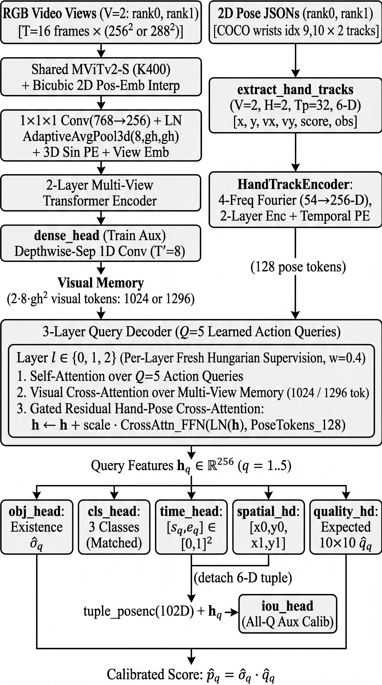

# Dual-Resolution Multi-View Action DETR with Hand-Trajectory Cross-Attention and Existence-Quality Calibration

## Authors & Affiliation

- **Authors:** Kaveh Safavigerdini, Kannappan Palaniappan
- **Affiliation:** EECS Department, University of Missouri, Columbia, MO, USA
- **Challenge Track:** RetailAction Challenge (PRAW Workshop @ WACV 2027) — Top-View Spatio-Temporal Action Localization
- **Final Public Leaderboard Score:** **`0.7942`** 
---

## 1. Executive Summary

We present a query-based multi-view spatio-temporal action localization framework for dual overhead retail cameras (`rank0` and `rank1`). Starting from a shared `MViTv2-S` video backbone and a 2-layer / 3-layer Transformer encoder-decoder with $Q=5$ learned action queries (`MultiViewActionDETR`), we systematically investigated why standard DETR-style formulations underperform on the class-agnostic 100-threshold RetailAction metric ($\text{TAU\_T} \in [0.05, 0.50] \times \text{TAU\_S} \in [0.10, 1.00]\text{ m}$).

Our final system (**V4**, Public Leaderboard **`0.7942`**, Local Validation **`0.8541`**, Local Test **`0.8420`**) combines five core components:
1. **Objectness/Class Decoupling & Per-Layer Fresh Hungarian Re-Matching (STMixer-style [5]):** Decouples query existence (`obj_head`, supervised with binary cross-entropy across all 5 queries) from action classification (cross-entropy restricted to matched queries), and re-runs Hungarian matching independently at every decoder layer (`w_aux = 0.4`).
2. **Dense Per-Frame Multi-Label Supervision & All-Query Continuous Quality Calibration (PointTAD [2] / VarifocalNet [1]-style):** Auxiliary frame-level multi-label supervision (`dense_head` [2]) sharpens backbone temporal boundaries, while continuous spatio-temporal IoU quality (`quality_head` [1] + geometry-conditioned `iou_head` with 102-D Fourier tuple encodings) calibrates query confidence.
3. **Residual Hand-Trajectory Cross-Attention (MV-TAP-style [6]):** Extracts 32-frame 2D wrist trajectories, velocities, and visibility flags from the provided per-clip top-view pose JSONs (`extract_hand_tracks`), encoding 128 spatiotemporal hand tokens that refine decoder queries via gated residual cross-attention without diluting visual cross-attention weights [6].
4. **Progressive Multi-Resolution Curriculum (`224×224` $\to$ `256×256` $\to$ Paired `256×256` + `288×288`):** Scales spatial token grids from $7\times 7$ ($98$ tokens/view) to $8\times 8$ ($128$ tokens/view) and $9\times 9$ ($162$ tokens/view) via bicubic 2D positional-embedding interpolation and activation checkpointing, with corrected `AdamW` weight-decay hygiene [3] and ranking-consistent checkpoint selection.
5. **Slot-Aligned 4-Pass TTA & Dual-Resolution Trajectory Ensembling [4]:** Because the 5 learned query slots preserve stable temporal-spatial specialization across fine-tuning and resolutions [4], we average per-slot predictions across 4 test-time augmentations (`s0`, `s1`, `flip`, `flip1`) and 4 complementary model states (`256px` RAW + EMA [3] and `288px` RAW + EMA [3]) without destructive NMS, followed by a single post-ensemble symmetric temporal boundary expansion (`pad_t = 0.015`).

---

## 2. Model Architecture

Given synchronized top-view RGB video streams from two overhead cameras ($V=2$, `rank0` and `rank1`) and their accompanying 2D human pose detections (`poses_rank0.json`, `poses_rank1.json`), our model `MultiViewActionDETR` predicts $Q=5$ action tuples per clip:
$$\hat{y}_q = \left(\hat{s}_q, \hat{e}_q, \hat{x}_{q,0}, \hat{y}_{q,0}, \hat{x}_{q,1}, \hat{y}_{q,1}, \hat{p}_q\right), \quad q \in \{1,\dots,5\}$$
where $[\hat{s}_q, \hat{e}_q] \subseteq [0,1]^2$ is the normalized temporal interval, $(\hat{x}_{q,v}, \hat{y}_{q,v}) \in [0,1]^2$ is the normalized 2D interaction point in camera view $v \in \{0,1\}$, and $\hat{p}_q \in (0,1)$ is the calibrated ranking score.





### 2.1 Shared Video Backbone & Resolution-Adaptive Token Grid
- **Backbone:** `torchvision` `mvit_v2_s` initialized with Kinetics-400 weights (`MViT_V2_S_Weights.KINETICS400_V1`), taking $T=16$ uniformly sampled RGB frames per view in chunks of 16.
- **3D Adaptive Spatio-Temporal Pooling:** Backbone tokens are reshaped to $(B, C_{768}, T', H', W')$, projected via $1\times 1\times 1$ convolution + LayerNorm to $d_{\text{model}}=256$, and pooled via `AdaptiveAvgPool3d((grid_t, grid_hw, grid_hw))` with `grid_t = 8` and resolution-matched spatial grids:
  - `224×224`: `grid_hw = 7` ($8 \times 7 \times 7 = 392$ tokens/view, $784$ multi-view tokens total)
  - `256×256`: `grid_hw = 8` ($8 \times 8 \times 8 = 512$ tokens/view, $1,024$ multi-view tokens total)
  - `288×288`: `grid_hw = 9` ($8 \times 9 \times 9 = 648$ tokens/view, $1,296$ multi-view tokens total)
- **Positional & View Embeddings:** 3D sinusoidal spatio-temporal positional embeddings (`sinusoidal_3d`) and learned camera view embeddings (`view_emb`: $2 \times 256$) are added to all visual tokens before concatenating both views into a unified multi-view memory sequence. When transitioning between spatial resolutions (`224` $\to$ `256` $\to$ `288`), the backbone's learned 2D spatial positional embedding `backbone.pos_hw` is bicubically interpolated on-the-fly (`model.py:L26-L31`).

### 2.2 Multi-View Transformer Encoder-Decoder & Hand-Pose Cross-Attention
- **Visual Encoder:** A 2-layer Pre-LN `TransformerEncoder` ($d=256$, $8$ heads, FFN dim $1024$, GELU, dropout $0.1$) performs joint self-attention across all spatio-temporal tokens from both camera views.
- **Hand-Trajectory Token Encoder (`HandTrackEncoder` [6]):** Top-view retail actions (shelf reaching, taking/returning items) are tightly coupled to wrist trajectories. From `poses_rank0.json` and `poses_rank1.json`, `extract_hand_tracks` extracts left and right wrist keypoints (COCO indices 9 and 10) for the two highest-confidence person tracks across $T_p=32$ uniformly sampled time steps per view, forming a $(V=2, H=2, T_p=32, 6)$ tensor of $[x, y, v_x, v_y, \text{score}, \text{obs}]$ with linear interpolation across occluded frames [6]. Each 6-D state is lifted with 4-frequency Fourier positional features (54-D total) and projected to 128 pose tokens of dimension $256$.
- **Residual Pose Cross-Attention:** Rather than concatenating pose tokens into the visual memory (which dilutes visual cross-attention softmax weights when warm-starting), each of the 3 Pre-LN `TransformerDecoder` layers applies standard visual cross-attention first, followed by a gated residual cross-attention block over the 128 hand-pose tokens (`scale` initialized to $0.05$) [6].

### 2.3 Prediction & Calibration Heads
From each decoder layer's query representations $h_q \in \mathbb{R}^{256}$ ($q=1\dots 5$):
1. **Existence / Objectness Head (`obj_head` [5]):** `Linear(256, 1)` predicting query existence probability $\hat{o}_q = \sigma(z^{\text{obj}}_q)$.
2. **Action Class Head (`cls_head` [5]):** `Linear(256, 4)` (3 action classes + auxiliary slot; supervised only on matched queries [5]).
3. **Temporal Head (`time_head`):** 2-layer MLP predicting $(\alpha_q, \beta_q) \in (0,1)^2$, parameterized as $\hat{s}_q = \alpha_q$ and $\hat{e}_q = \alpha_q + (1 - \alpha_q)\beta_q$ to guarantee $0 \le \hat{s}_q \le \hat{e}_q \le 1$.
4. **Multi-View Spatial Head (`spatial_head`):** 3-layer MLP predicting normalized 2D coordinates $[\hat{x}_{q,0}, \hat{y}_{q,0}, \hat{x}_{q,1}, \hat{y}_{q,1}] \in (0,1)^4$.
5. **Expected Metric Quality Head (`quality_head` [1]):** 2-layer MLP predicting $\hat{q}_q = \sigma(z^{\text{qual}}_q)$, supervised against the exact expected match fraction over the $10 \times 10$ challenge evaluation threshold grid.
6. **Geometry-Conditioned All-Query IoU Head (`iou_head` [1]):** Concatenates $h_q$ with a 102-D multi-frequency sinusoidal encoding (`tuple_posenc`) of the detached 6-D coordinate tuple $[\hat{s}_q, \hat{e}_q, \hat{x}_{q,0}, \hat{y}_{q,0}, \hat{x}_{q,1}, \hat{y}_{q,1}]$ and predicts all-query overlap quality across both matched and unmatched queries.
7. **Dense Per-Frame Auxiliary Head (`dense_head` [2], training only):** Pools multi-view encoder memory spatially per temporal bin ($T'=8$) and applies a depthwise-separable 1D temporal convolution to predict frame-level multi-label action probabilities [2].

---

## 3. Training Data & Preprocessing

- **Dataset:** Official RetailAction Challenge dataset exclusively (**no external video or retail datasets** were used; only standard Kinetics-400 initialization for `mvit_v2_s` from `torchvision`).
  - **Train split:** `2,519` dual-view clips (`annotations/annotations_train.json`)
  - **Validation split:** `1,277` dual-view clips (`annotations/annotations_validation.json`)
  - **Local Test split:** `2,501` dual-view clips (`annotations/annotations_test.json`)
  - **Challenge split:** `2,500` unlabeled dual-view clips (`sample_submission.csv`)
- **Physical Scale Calibration:** Following the challenge specification, per-view pixel-to-meter conversion factors (`meters_per_unit`) are computed from the median limb-length ratios of detected 2D skeletons against anatomical reference lengths (`util.py:L15-L43`), defaulting to $3.5\text{ m}$ when fewer than 3 valid limbs are visible.
- **Training Augmentations:** Random temporal jitter (`±1` frame offset around uniform 16-frame linspace sampling) and independent per-view horizontal flipping ($p=0.5$), which simultaneously flips the RGB frames (`x -> W - 1 - x`), ground-truth interaction $x$-coordinates (`x -> 1 - x`), and extracted hand-track $x$-positions/velocities (`x -> 1 - x`, `vx -> -vx`) while swapping left/right wrist indices.

---

## 4. Training Recipe & Progressive Curriculum

### 4.1 Multi-Task Loss Formulation
At each of the 3 decoder layers ($l \in \{0,1,2\}$, with layer weights $w_0=0.4, w_1=0.4, w_2=1.0$), we run **fresh Hungarian matching** (`HungarianMatcher` [5]) with cost matrix:
$$\mathcal{C}_{q,m} = w_{\text{cls}}\left(-\hat{P}_{q, c_m}\right) + w_{\text{obj}}\left(-\hat{o}_q\right) + w_s \|\hat{\mathbf{x}}_q - \mathbf{x}_m\|_1 + w_t\left(\|\hat{\mathbf{t}}_q - \mathbf{t}_m\|_1 - \text{GIoU}_t(\hat{\mathbf{t}}_q, \mathbf{t}_m)\right)$$
with $w_{\text{cls}}=1, w_{\text{obj}}=2, w_s=5, w_t=5$. Given the matched pairs, the per-layer loss is:
$$\mathcal{L}_{\text{layer}} = 2.0\,\mathcal{L}_{\text{obj-BCE}}^{\text{all } Q} + 1.0\,\mathcal{L}_{\text{cls-CE}}^{\text{matched}} + 5.0\,\mathcal{L}_{\text{spatial-}L_1} + 5.0\,\mathcal{L}_{\text{temp-}L_1} + 2.0\,\mathcal{L}_{\text{temp-DIoU}} + 0.2\,\mathcal{L}_{\log\text{-dur}} + 4.0\,\mathcal{L}_{\text{qual-BCE}} + 3.0\,\mathcal{L}_{\text{iou-BCE}}^{\text{all } Q} + 1.0\,\mathcal{L}_{\text{iou-rank}}$$
plus the encoder-level dense per-frame loss $3.0\,\mathcal{L}_{\text{dense-BCE}}$ [2] (active even on zero-GT clips). Crucially, quality targets $q^*_q \in [0,1]$ [1] are computed under `torch.no_grad()` as the exact fraction of the 100 evaluation thresholds $(\tau_t, \tau_s)$ satisfied by the query:
$$q^*_q = \left(\frac{1}{10}\sum_{\tau_t \in \text{TAU\_T}} \mathbb{I}[\text{tIoU}_q > \tau_t]\right) \cdot \left(\frac{1}{10}\sum_{\tau_s \in \text{TAU\_S}} \mathbb{I}[\min(d_{q,0}, d_{q,1}) < \tau_s]\right)$$

### 4.2 Progressive Training Stages
All stages use `AdamW` with weight-decay hygiene [3] (weight decay `1e-4` applied strictly to $\ge 2$-D `Linear`/`Conv` weight matrices; `0.0` on all biases, LayerNorms, positional embeddings, and query tokens), `bfloat16` mixed precision, gradient norm clipping at `1.0`, cosine learning rate schedule, and exponential moving average (`ModelEma` [3]).

| Stage | Checkpoint | Init From | Resolution (`grid_hw`) | Epochs | Batch $\times$ Accum | Base / Backbone / New-Head LR | Key Additions | Val `mAP` | Local Test `mAP` | Public LB |
|---|---|---|---:|---:|---:|---|---|---:|---:|---:|
| Host Baseline | — | — | `224` (`7×7`) | — | — | — | Official challenge baseline | — | — | `0.3910` |
| Stage 1 (`v2`) | `run2q` | Kinetics-400 | `224` (`7×7`) | 12 | $4 \times 4$ | `1e-4` / `1e-5` / — | Base `MultiViewActionDETR` + `quality_head` [1] | `0.6171` | `0.5972` | `0.5558` |
| Stage 2 (`idea_07`) | `ab_diou_ema` | `run2q` | `224` (`7×7`) | 4 | $8 \times 4$ | `5e-5` / `5e-6` / — | Temporal DIoU + `ModelEma(0.999)` + WD-hygiene [3] | `0.7034` | `0.6877` | — |
| Stage 3 (`idea_11`) | `stmixer_ft` | `ab_diou_ema` | `224` (`7×7`) | 3 | $8 \times 4$ | `5e-5` / `5e-6` / `5e-4` | `obj_head` BCE + matched-only CE + per-layer re-matching (`w_aux=0.4`) [5] | `0.7864` | `0.7743` | — |
| Stage 4 (`v2_comb`) | `combine_v2a` | `stmixer_ft` (EMA) | `224` (`7×7`) | 4 | $8 \times 4$ | `4e-5` / `4e-6` / `5e-4` | `dense_head` (`w=3.0`) [2] + `wq=4.0` [1] + 4-pass TTA (`f4`) [4] + noNMS + `EMA+RAW` [3] | `0.8157` | `0.8082` | `0.7580` |
| Stage 5a (`v3a`) | `combine_v3a` | `combine_v2a` (EMA) | `224` (`7×7`) | 4 | $16 \times 2$ | `3e-5` / `3e-6` / `5e-4` | `HandTrackEncoder` pose cross-attn [6] + `iou_head` [1] + `log_w` + `pad_t=0.015` | `0.8404` | `0.8340` | — |
| Stage 5b (`v3b`) | `combine_v3b_256` | `combine_v3a` (EMA) | `256` (`8×8`) | 2 | $16 \times 2$ | `1.5e-5` / `2e-6` / `1e-4` | Spatial curriculum $7\times 7 \to 8\times 8$; multi-res ensemble [4] | `0.8486` | `0.8384` | `0.7882` |
| **Stage 6 (`V4`)** | **`v4_control256` + `v4_high288`** | `combine_v3b_256` (RAW) | **`256` (`8×8`) + `288` (`9×9`)** | **2 + 2** | **$16 \times 2$** | **`1e-5` / `1.5e-6` / `5e-5`** | **Paired `256px` + `288px` continuations, fixed `AdamW` `weight_decay`, partial-accum fix, 4-member `common288` ensemble** | **`0.8541`** | **`0.8420`** | **`0.7942`** |

### 4.3 Engineering Fixes in V4
In Stage 6 (**V4**), we corrected three subtle training-loop issues present in earlier stages:
1. **`AdamW` Weight-Decay Key Fix:** Earlier parameter-group dictionaries passed `"wd"` instead of PyTorch's `"weight_decay"`, causing `AdamW` to silently fall back to its default `1e-2` weight decay on bias/norm groups. Fixing `"weight_decay"` restored true zero-decay hygiene on 1D parameters and `1e-4` on 2D weights.
2. **Exact Partial-Batch Gradient Accumulation:** Handled the final partial batch of each epoch ($158 \text{ batches} \equiv 79 \text{ optimizer steps}$) without dropping or mis-scaling trailing gradients.
3. **Ranking-Consistent Checkpoint Selection:** Selected `best.pt` using the deployment ranking score (`obj*q`) on both RAW and EMA weights (`max(raw_mAP, ema_mAP)`).

---

## 5. Post-Processing, Test-Time Augmentation, and Ensembling

### 5.1 Calibrated Query Scoring (`obj*q`)
Because the official RetailAction evaluation metric is class-agnostic (`c` is the maximum score across predicted classes), ranking queries by classification probability suffers from class-split dilution. We rank every query slot by the product of existence probability [5] and expected metric quality [1]:
$$s_q = \sigma\left(z^{\text{obj}}_q\right) \cdot \sigma\left(z^{\text{qual}}_q\right)$$

### 5.2 Slot-Aligned 4-Pass Test-Time Augmentation (`f4` [4])
Because our $Q=5$ learned query slots maintain stable ordering across augmentations [4], we average predictions slot-by-slot across 4 complementary passes per model:
- `s0`: Standard 16-frame uniform linspace sampling (`frame_shift = 0`).
- `s1`: +1 frame temporal phase shift (`frame_shift = 1`), reducing temporal discretization error on short actions.
- `flip`: Horizontal mirror of both camera views and hand tracks (`vids.flip(-1)`), un-mirroring predicted $x$-coordinates ($\hat{x} \leftarrow 1 - \hat{x}$) before slot averaging.
- `flip1`: Combined +1 frame temporal shift and horizontal mirror.

### 5.3 4-Member Dual-Resolution & Dual-Trajectory Ensemble (`high_plus_control`)
We combine two paired checkpoints trained from `combine_v3b_256` with seed `44`:
- **`v4_control256/best.pt`** (`256×256`, `grid_hw = 8`): both **EMA** (`c_ema`) and **RAW** (`c_raw`) weight trajectories.
- **`v4_high288/best.pt`** (`288×288`, `grid_hw = 9`): both **EMA** (`h_ema`) and **RAW** (`h_raw`) weight trajectories.

All 4 members are evaluated from a unified `common_size = 288` loader (each model internally resizes the batch to its native resolution `256` or `288`) with equal weights (`1 : 1 : 1 : 1`, totaling $4 \times 4 = 16$ passes per clip). For each query slot $q \in \{1\dots 5\}$, temporal bounds, 2D spatial coordinates, and `obj*q` scores are averaged arithmetically across all 16 renderings.

### 5.4 Why No NMS + Single Post-Ensemble Temporal Boundary Padding (`pad_t = 0.015`)
- **No NMS:** Once `obj_head` is supervised across all 5 queries with matched-only class CE [5], duplicate query collapse disappears; applying greedy NMS [3] degrades validation mAP by $\sim 1.0\text{ pp}$ by discarding legitimate secondary actions in multi-action clips. We therefore emit all 5 queries per clip (`12,500` actions across `2,500` clips).
- **Post-Ensemble Temporal Padding (`pad_t = 0.015`):** Sigmoid-activated temporal regression heads slightly under-predict start/end boundaries near action onset and completion. Expanding each ensemble-averaged interval symmetrically once by $1.5\%$ of clip duration:
  $$[\hat{s}_q, \hat{e}_q] \leftarrow \left[\max(0, \hat{s}_q - 0.015), \min(1, \hat{e}_q + 0.015)\right]$$
  consistently improves strict temporal AP ($\tau_t = 0.50$).

---

## 6. Quantitative Results & Ablations

| Method / Configuration | Full Val `mAP` (`1,277`) | Val `mAPs` | Val `mAPt` | Local Test `mAP` (`2,501`) | Test `mAPs` | Test `mAPt` | Public LB |
|---|---:|---:|---:|---:|---:|---:|---:|
| Official Host Baseline | — | — | — | — | — | — | `0.3910` |
| V2 Baseline (`run2q`, single pass, `cls` rank) | `0.6171` | `0.7610` | `0.7330` | `0.5972` | `0.7420` | `0.7190` | `0.5558` |
| + DIoU + EMA + NMS + `product` (`idea_07` [1, 3]) | `0.7034` | `0.8184` | `0.7874` | `0.6877` | `0.8051` | `0.7742` | — |
| + STMixer `obj_head` + Per-Layer Re-Matching (`idea_11` [5]) | `0.7864` | `0.8647` | `0.8680` | `0.7743` | `0.8519` | `0.8610` | — |
| + Dense Per-Frame Head + `f4` TTA + `EMA+RAW` (`combine_v2` [2, 3, 4]) | `0.8157` | `0.8840` | `0.8850` | `0.8082` | `0.8717` | `0.8827` | `0.7580` |
| + Pose Cross-Attn + `iou_head` + `256px` Grid (`combine_v3` [1, 6]) | `0.8486` | `0.8965` | `0.9117` | `0.8384` | `0.8869` | `0.9087` | `0.7882` |
| V4 `256px` Control Only (`c_ema + c_raw`, `f4`, `common288`) | `0.8515` | `0.8961` | `0.9154` | — | — | — | — |
| V4 `288px` High-Res Only (`h_ema + h_raw`, `f4`, `common288`) | `0.8512` | `0.8977` | `0.9156` | — | — | — | — |
| **V4 Final (`c_ema + c_raw + h_ema + h_raw`, `f4`, `pad_t=0.015`)** | **`0.8541`** | **`0.8989`** | **`0.9176`** | **`0.8420`** | **`0.8878`** | **`0.9127`** | **`0.7942`** |

---

## 7. Reproducing the `0.7942` Kaggle Submission

From the root of the submission repository:

```bash
# 1. Install dependencies (or use the provided Dockerfile)
pip install -r requirements.txt

# 2. Download the trained weights zip from Google Drive and unzip
#    so the checkpoints land in weights/ beside the cloned files:
#    https://drive.google.com/file/d/1RXN2al-A_ycb381IqEHMPovggk4NlwM1/view?usp=sharing
#    unzip RetailAction_weights.zip -d weights/
# 3. Place or symlink the official dataset under data/raw/
#    (containing videos/, annotations/, and sample_submission.csv)

# 4. Run the standalone reproduction script using the trained weights in weights/
python reproduce_submission.py --data-root data/raw --out submission.csv
#    (byte-identical to the uploaded Kaggle artifact: combine_ideas_v4_0.7942.csv)
```

The script automatically verifies that `submission.csv` contains all `2,500` challenge clip IDs in exact `sample_submission.csv` order, `12,500` valid actions (`5` per clip), sorted scores in $[0,1]$, valid coordinates/intervals in $[0,1]$, and compares against the reference `0.7942` submission.

---

## 8. References

[1] Haoyang Zhang, Ying Wang, Feras Dayoub, and Niko Sünderhauf. "VarifocalNet: An IoU-aware Dense Object Detector." In *Proceedings of the IEEE/CVF Conference on Computer Vision and Pattern Recognition (CVPR)*, pp. 8514–8523, 2021.

[2] Jing Tan, Xiaotong Zhao, Xintian Shi, Bin Kang, and Limin Wang. "PointTAD: Multi-Label Temporal Action Detection with Learnable Query Points." In *Advances in Neural Information Processing Systems (NeurIPS)*, vol. 35, pp. 15268–15280, 2022.

[3] Chen-Lin Zhang, Jianxin Wu, and Yin Li. "ActionFormer: Localizing Moments of Actions with Transformers." In *European Conference on Computer Vision (ECCV)*, pp. 492–510, 2022.

[4] Shimon Hori and Toru Tamaki. "Query Matching for Spatio-Temporal Action Detection with Query-Based Object Detector." In *IEEE 14th Global Conference on Consumer Electronics (GCCE)*, 2025 (arXiv:2409.18408).

[5] Tao Wu, Mengqi Cao, Ziteng Gao, Gangshan Wu, and Limin Wang. "STMixer: A One-Stage Sparse Action Detector." In *Proceedings of the IEEE/CVF Conference on Computer Vision and Pattern Recognition (CVPR)*, pp. 14720–14729, 2023.

[6] Jahyeok Koo, Inès Hyeonsu Kim, Mungyeom Kim, Junghyun Park, Seohyun Park, Jaeyeong Kim, Jung Yi, Seokju Cho, and Seungryong Kim. "MV-TAP: Tracking Any Point in Multi-View Videos." In *Proceedings of the IEEE/CVF Conference on Computer Vision and Pattern Recognition (CVPR)*, 2026 (arXiv:2512.02006).
